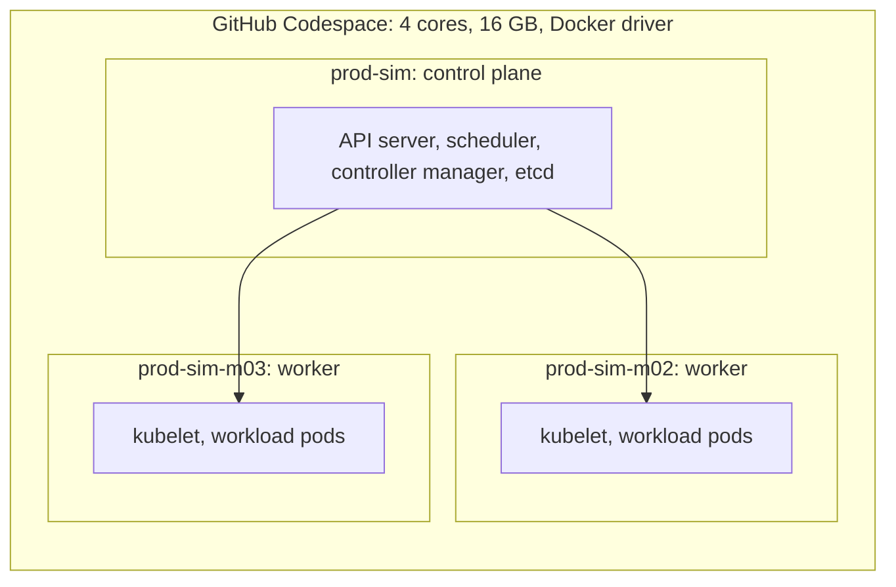
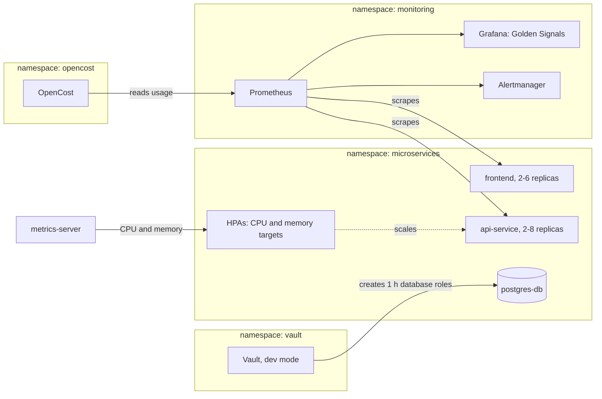
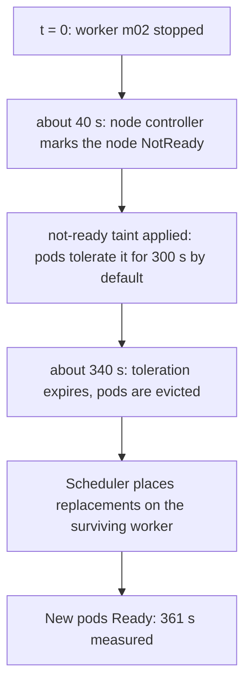
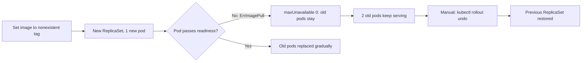
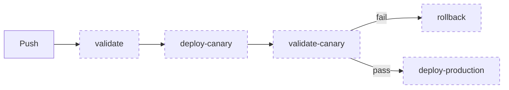

# Auto-Healing Kubernetes Platform

A 3-node Kubernetes reference platform built to answer one question: **what happens when things fail, and how much of the recovery needs a human?** It covers node loss, a bad deployment, a traffic spike, secret handling, observability and cost visibility, with every result measured and every gap documented.

**Author:** Olamide Olalekan, Platform & DevSecOps Engineer
[GitHub](https://github.com/velrite) | [LinkedIn](https://linkedin.com/in/olamide-olalekan-12138a265) | velrite.tech@gmail.com

> **Environment:** Minikube on a single GitHub Codespace (3 Docker containers acting as nodes). This is a lab platform. It shows how Kubernetes behaves, not how a multi-machine production cluster performs.

## Contents
1. [Results at a glance](#results-at-a-glance)
2. [What was built](#what-was-built)
3. [Architecture](#architecture)
4. [Failure engineering](#failure-engineering)
5. [Security](#security)
6. [Observability and its limits](#observability-and-its-limits)
7. [CI/CD status](#cicd-status)
8. [Incidents](#incidents)
9. [Quick start](#quick-start)
10. [Known gaps](#known-gaps)
11. [Documentation](#documentation)
12. [Evidence](#evidence)

## Results at a glance
Measured on a fresh rebuild in October 2026. Full detail: [docs/VERIFIED_RUN.md](docs/VERIFIED_RUN.md).

| Test | Result | Status |
|---|---|---|
| Worker node failure | Pods rescheduled after **361 s** (target 120 s) | **SLO not met**, cause understood |
| Bad image deployment | New pod stuck in ErrImagePull, 2 old pods kept serving, rolled back in **30 s** | Measured, rollback was manual |
| HPA scale-up | CPU 366% of request, replicas **2 to 8** | Measured |
| HPA scale-down | Back to 2 replicas with no manual scaling | Measured |
| Vault dynamic credentials | Different username and password on every read, 1 h TTL | Measured |
| Vault KV v2 rotation | Version 1 to 2, pods stayed Running | Measured (see Security for limits) |
| OpenCost | Real per-pod cost from the allocation API | Measured |
| Prometheus | 21 scrape targets up, 0 down; 6 custom alerts, 140 alerting rules loaded in total | Measured |
| CI pipeline | Workflow file not in this repo | **Not re-verified** |

## What was built
| Area | Components |
|---|---|
| Workloads (`microservices`) | `api-service` (nginx, HPA 2-8, CPU 60% / memory 70%), `frontend` (nginx, HPA 2-6, CPU 65%), `postgres-db`, LimitRange, ResourceQuota (20 pods) |
| Monitoring (`monitoring`) | Prometheus, Alertmanager, Grafana (Golden Signals dashboard), 6 custom alert rules |
| Secrets (`vault`) | HashiCorp Vault in dev mode, Kubernetes auth, database secrets engine, KV v2 |
| FinOps (`opencost`) | OpenCost with `team`, `cost-center`, `environment` labels on all deployments |

 <em>OpenCost returning real per-pod cost from the allocation API</em>

## Architecture

### 1. Cluster topology

Each node is a Docker container on one machine, so this models Kubernetes behaviour, not multi-machine failure domains. Three nodes let one worker be lost while another remains to take the pods.

 <em>Three nodes Ready on Kubernetes v1.31.0</em>

 <em>Four platform namespaces Active</em>

 <em>All platform pods Running</em>

### 2. Namespaces and data flow

No application currently reads Vault credentials. Vault proves dynamic credential generation against Postgres, not an application consuming them.

### 3. Node failure timeline

The timings are Kubernetes defaults and match the measured 361 s. Lowering `tolerationSeconds` on the deployments is the fix and is listed under Known gaps.

### 4. Bad deployment containment

Containment is automatic. The rollback is a manual step.

### 5. CI/CD pipeline (not re-verified)

Dashed means not re-verified. The workflow file is not in this repository, and the deploy and rollback stages were simulated with echo commands.

### Components
| Component | Role | Depends on | If it fails |
|---|---|---|---|
| Control plane | Scheduling, reconciliation, API | Docker network | Existing pods keep running, no new scheduling or healing |
| Worker nodes | Run workload pods | Control plane, node internet for image pulls | Pods rescheduled after the eviction delay (361 s measured) |
| api-service | Autoscaled demo backend | metrics-server, memory request set to 128Mi | HPA stops scaling if metrics are missing |
| postgres-db | Database for Vault role creation | `postgres-secret`, `postgres-db` Service | Vault database engine cannot create credentials |
| Prometheus | Metrics and alert evaluation | ServiceMonitors, `release: prometheus` label on rules | No alerts, OpenCost has no data |
| Grafana | Dashboards | Prometheus datasource | Visibility lost, platform unaffected |
| Vault (dev mode) | Dynamic credentials, KV v2 | postgres-db | Configuration lost on restart |
| OpenCost | Cost per pod and namespace | Prometheus | No cost data |

### Design decisions
| Decision | Reason | Trade-off |
|---|---|---|
| 3 nodes, not 1 | A node-failure test needs somewhere to reschedule | More memory, slower start |
| Vault dev mode | No unseal step per Codespace restart | No persistence, no TLS |
| OpenCost, not Kubecost | Kubecost failed on storage permissions and bundled its own Prometheus | Less UI, same cost model |
| Fewer scrape targets | Minikube does not expose etcd, scheduler, controller-manager or kube-proxy | Control-plane internals unmonitored |
| Pinned minikube 1.34.0 | v1.39 control plane never became Ready here | Older tooling |

Full decision records: [docs/ADR.md](docs/ADR.md)

## Failure engineering
Each test states a hypothesis, introduces a controlled failure, measures the result, and records what the test cannot prove.

### Node failure
- **Hypothesis:** losing a worker is recovered without a human within 120 s.
- **Experiment:** `minikube node stop prod-sim-m02` while api-service pods run.
- **Observed:** pods moved to the surviving nodes with no manual command. **Recovery took 361 s.**
- **Outcome:** the 120 s target was **not met**. Kubernetes adds a default 300 s toleration to the `not-ready` taint before evicting pods from a dead node, which matches the result.
- **Limit:** one run, no repeated trials. An earlier 20 s figure in this project's history was not reproduced.
- **Next step:** lower `tolerationSeconds` for `node.kubernetes.io/not-ready` and `unreachable` on the deployments, then re-test.

 <em>Node stopped; pods rescheduled after 361 s, so the 120 s target was missed</em>

### Bad deployment
- **Hypothesis:** a broken image never replaces healthy pods.
- **Experiment:** set the api-service image to `kennethreitz/httpbin:this-tag-does-not-exist`.
- **Observed:** the new pod entered ErrImagePull. The 2 old pods stayed Running and kept serving. `maxUnavailable: 0` blocks termination of old pods until a new pod is ready, and a broken image never becomes ready.
- **Measured:** **30 s** from the bad image to a completed rollback. That includes a deliberate 30 s wait before running `kubectl rollout undo`.
- **Limit:** the rollback was **issued by hand**. The test proves containment (zero blast radius), not automatic rollback.

 <em>Bad image stuck in ErrImagePull while 2 old pods kept serving; rollback in 30 s</em>

### HPA traffic spike
- **Hypothesis:** api-service scales from 2 to 8 pods above 60% CPU and returns to 2 when load stops.
- **Experiment:** 3 busybox pods sending continuous requests.
- **Observed:** CPU reached 366% of request (HPA reading) and replicas reached 8. After the load was removed, replicas returned to 2 without manual scaling.
- **Fix needed:** at the default memory request, memory stayed above the 70% target and held the HPA at 8 replicas even with CPU at 2%. The api-service memory request was raised to 128Mi (limit 256Mi). This is applied by `scripts/revive.sh` but is **not yet in `manifests/api-service.yaml`**.
- **Limit:** the load is synthetic and uniform.

 <em>HPA targets: api-service 2-8, frontend 2-6</em>

 <em>Baseline: 2 replicas, low CPU</em>

 <em>Under load: CPU far above target, replicas scaled up</em>

 <em>After load removed: back to 2 replicas with no manual scaling</em>

## Security
- **No credentials in pod descriptions.** `kubectl describe pod | grep -i password` returns nothing for api-service. postgres-db references `postgres-secret` by key only.

 <em>No password value in the pod description</em>

- **Dynamic credentials.** Each `vault read database/creds/api-service-role` returns a new username and password that expires in 1 hour.

 <em>Two reads, two different credentials, 1 h lease</em>

- **KV v2 rotation.** A secret was written as version 1 and then version 2 while pods stayed Running. No application reads this secret, so this shows versioning works, not that a live application survives rotation.

 <em>KV v2 version 1 to 2 with pods still Running</em>

- **Earlier documentation was wrong about the Vault database failure.** It blamed port-forwarding. The real cause was a missing `postgres-db` Service, which is now in `database.yaml`.
- **Vault runs in dev mode.** It has a root token, no TLS and no persistence, so its configuration is lost on restart. Not production-ready.
- **Not implemented:** NetworkPolicies, Pod Security Standards, image signing, admission control. Kubernetes Secrets are base64-encoded, not encrypted.

## Observability and its limits
- Prometheus shows **21 targets, all up**. etcd, scheduler, controller-manager and kube-proxy monitoring are disabled because Minikube does not expose them.
- The Golden Signals dashboard has four panels (Traffic, Error Rate, Latency P99, Saturation). **Only Saturation shows data.** nginx exposes no `http_requests_total` or latency histograms, so the other three need an instrumented application. The queries are unchanged.
- The October dashboard was imported through the Grafana API because the ConfigMap did not load.
- The earlier "36 alert rules" was not supported by the repo, which defines **6 custom alerts**. Prometheus loads 140 alerting rules in total, including the stack's defaults.

 <em>6 custom alert rules, 140 alerting rules loaded in total</em>

## CI/CD status
- A GitHub Actions pipeline (validate, canary, validate-canary, rollback, deploy-production) ran earlier. Screenshot 15 shows that run in the original repository's Actions history.
- **`.github/workflows/` is not in this repository** (lost during history rewrites), so the pipeline cannot currently be re-run or audited from this repo.
- The deploy and rollback stages were **simulated with echo commands**, because a GitHub runner cannot reach a Minikube cluster inside a Codespace.
- The "48 second" duration comes from that earlier run and has not been re-measured.

 <em>CI run from the original repository (earlier run, not re-verified)</em>

## Incidents
| Incident | Root cause | Resolution | Verified by |
|---|---|---|---|
| Workers could not join the cluster | `bridge-nf-call-iptables=1` sent container-to-container traffic through a host firewall that dropped it | Set to 0 | 3 nodes Ready |
| Pods in ImagePullBackOff | Legacy iptables `FORWARD` policy was DROP, blocking node egress | Set to ACCEPT, added MASQUERADE for 192.168.49.0/24 | Nodes reached Docker Hub and registry.k8s.io |
| Control plane never Ready | minikube v1.39 defaults to a newer containerd | Pinned minikube v1.34.0, Docker runtime | Control plane Ready |
| API server timeouts during install | Full stack on 8 GB / 2 cores; swap unsupported on the filesystem | Moved to 16 GB / 4 cores | Stack stable |
| HPA stuck at 8 replicas | Memory above the 70% target at the default request | Raised memory request to 128Mi | Scaled back to 2 |
| Vault database engine failed | No Service for postgres-db | Added the Service | Dynamic credentials returned |
| docker-proxy missing | Codespace moby-engine omits it | Installed the binary from the docker-ce package | Cluster started |
| Credential committed to Git | Hardcoded password in a public repo | History rewrite with git-filter-repo, force push | Search of history returns nothing |
| Large binaries committed | `git add .` picked up kubectl, minikube, vault | filter-branch rewrite, .gitignore | Clean push |

Details: [docs/INCIDENTS.md](docs/INCIDENTS.md).

## Quick start
**Requirements:** GitHub Codespace with **4 cores / 16 GB**. The full stack does not fit reliably on 2 cores / 8 GB.

~~~bash
bash scripts/revive.sh
~~~

The script installs pinned tools (kubectl 1.31.0, minikube 1.34.0, Helm), applies the Docker and network fixes, builds or restarts the 3-node cluster, deploys everything, reconfigures Vault, and prints a PASS/FAIL report. After a restart run `bash scripts/pf.sh` to restore port-forwards.

Why the fixes are needed: [docs/CODESPACE_RUNBOOK.md](docs/CODESPACE_RUNBOOK.md). The script assumes a Codespace (`/workspaces/...`).

## Known gaps
| Gap | Impact | Fix |
|---|---|---|
| Node recovery 361 s vs 120 s target | SLO missed | Lower `tolerationSeconds`, re-test |
| Rollback is manual | Containment shown, automation not | Argo Rollouts or CI-driven rollback against a reachable cluster |
| 128Mi memory request not in manifests | Fresh `kubectl apply` reproduces the stuck HPA | Move it into `manifests/api-service.yaml` |
| Workflow file missing | CI not auditable | Restore from the original repo's history |
| nginx exposes no metrics | 3 of 4 Golden Signals empty | Use an instrumented application |
| Vault in dev mode | Config lost on restart | Standalone or HA with auto-unseal |
| No NetworkPolicies, PDBs, image signing | Lateral movement possible | Default-deny policies, PDBs, cosign |
| Single run per test | No variance claimed | Repeat each test and report the spread |

## Documentation
| File | Contents |
|---|---|
| [VERIFIED_RUN.md](docs/VERIFIED_RUN.md) | October 2026 measurements, changes and corrections |
| [CODESPACE_RUNBOOK.md](docs/CODESPACE_RUNBOOK.md) | Why Codespaces needs extra fixes, and how to recover |
| [ARCHITECTURE.md](docs/ARCHITECTURE.md) | Cluster design and reconciliation model |
| [TESTING_AND_VALIDATION.md](docs/TESTING_AND_VALIDATION.md) | Test procedures and output (original run) |
| [SECURITY.md](docs/SECURITY.md) | Vault setup and credential handling |
| [INCIDENTS.md](docs/INCIDENTS.md) | Incident history |
| [ADR.md](docs/ADR.md) | Architectural decisions and rejected alternatives |
| [RUNBOOK.md](docs/RUNBOOK.md) | Operating procedures |
| [GAPS.md](docs/GAPS.md) | What was not built |
| [CAPACITY_AND_COST.md](docs/CAPACITY_AND_COST.md) | Resource use and OpenCost results |

## Evidence
Each screenshot sits next to the claim it supports. Files are in [`docs/evidence/`](docs/evidence/). Vault passwords are blurred. The CI screenshot is from an earlier run.
