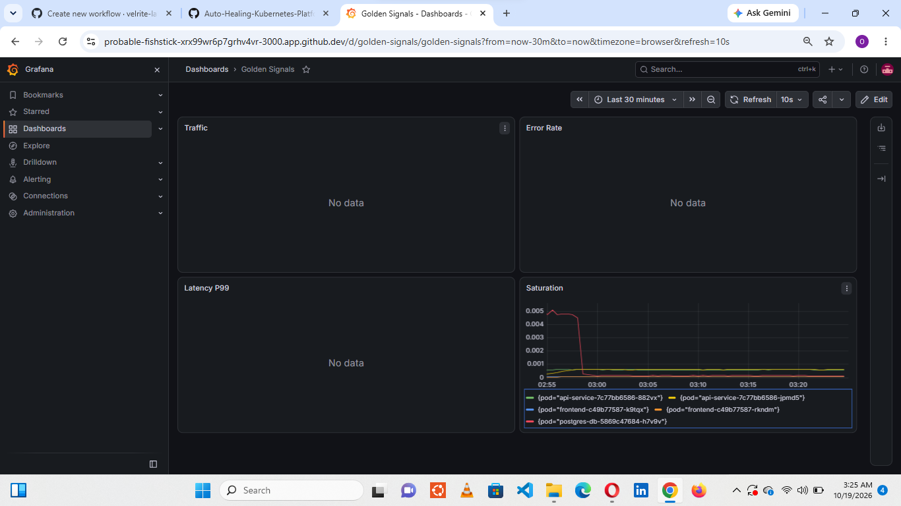
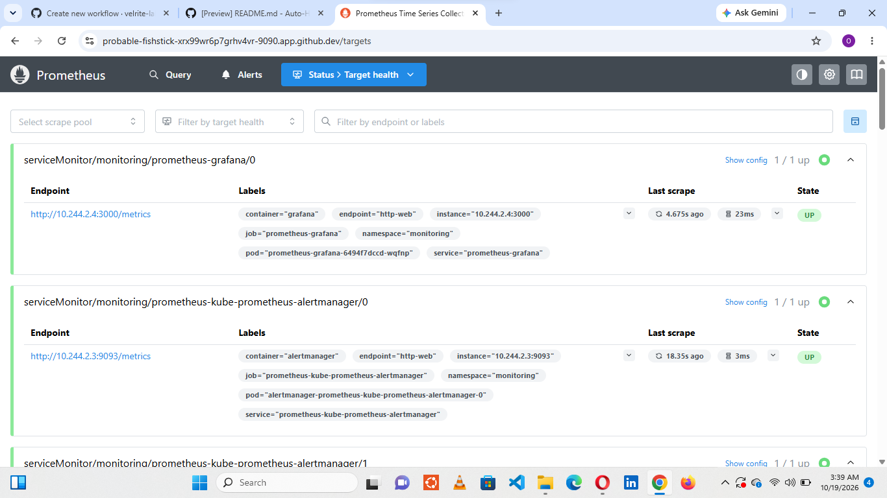

# Evidence index

Each entry shows what the screenshot proves, the command behind it and the result to expect. Files are named `NN-name.png` in this folder. All are from the October 2026 run except 15.

| # | Evidence | File |
|---|---|---|
| 01 | [3 nodes Ready on v1.31.0](#01-cluster-nodes) | `01-cluster-nodes.png` |
| 02 | [4 platform namespaces exist](#02-namespaces) | `02-namespaces.png` |
| 03 | [Whole platform healthy](#03-all-pods-running) | `03-all-pods-running.png` |
| 04 | [HPA targets and limits](#04-hpa-config) | `04-hpa-config.png` |
| 05 | [Alert rules loaded](#05-alert-rules) | `05-alert-rules.png` |
| 06 | [Baseline before load](#06-hpa-before-load) | `06-hpa-before-load.png` |
| 07 | [Autoscaling reacts to load](#07-hpa-during-load) | `07-hpa-during-load.png` |
| 08 | [Scale-down without manual action](#08-hpa-scale-down) | `08-hpa-scale-down.png` |
| 09 | [Node failure recovery time](#09-node-recovery) | `09-node-recovery.png` |
| 10 | [Bad image contained, then rolled back](#10-bad-deploy-rollback) | `10-bad-deploy-rollback.png` |
| 11 | [No password in pod description](#11-zero-credentials) | `11-zero-credentials.png` |
| 12 | [Dynamic credentials](#12-vault-dynamic-secrets) | `12-vault-dynamic-secrets.png` |
| 13 | [KV v2 versioning](#13-secret-rotation) | `13-secret-rotation.png` |
| 14 | [Per-pod cost data](#14-opencost-data) | `14-opencost-data.png` |
| 15 | [CI run (earlier, original repo)](#15-github-actions-green) | `15-github-actions-green.png` |
| 16 | [Golden Signals dashboard](#16-grafana-dashboard) | `16-grafana-dashboard.png` |
| 17 | [Prometheus scraping the cluster](#17-prometheus-targets) | `17-prometheus-targets.png` |

## 01-cluster-nodes
**Proves:** 3 nodes Ready on v1.31.0

```bash
kubectl config current-context
kubectl get nodes -o wide
```
**Result:** prod-sim, prod-sim-m02, prod-sim-m03, all Ready


## 02-namespaces
**Proves:** 4 platform namespaces exist

```bash
kubectl get namespaces
```
**Result:** microservices, monitoring, vault, opencost Active


## 03-all-pods-running
**Proves:** Whole platform healthy

```bash
kubectl get pods --all-namespaces | grep -v Completed | grep -v kube-system
```
**Result:** All platform pods Running


## 04-hpa-config
**Proves:** HPA targets and limits

```bash
kubectl get hpa -n microservices
```
**Result:** api-service 2-8, frontend 2-6, real CPU values (not unknown)


## 05-alert-rules
**Proves:** Alert rules loaded

```bash
kubectl get prometheusrule microservices-alerts -n monitoring -o yaml | grep "alert:"
```
**Result:** 6 custom alerts; Prometheus reports 140 alerting rules in total


## 06-hpa-before-load
**Proves:** Baseline before load

```bash
kubectl get hpa -n microservices
```
**Result:** 2 replicas, CPU a few %


## 07-hpa-during-load
**Proves:** Autoscaling reacts to load

```bash
kubectl get hpa -n microservices
```
**Result:** CPU far above the 60% target. Captured mid-scale at 4 replicas; replicas reached 8 later in the same test


## 08-hpa-scale-down
**Proves:** Scale-down without manual action

```bash
kubectl get hpa -n microservices
```
**Result:** Back to 2 replicas after the default scale-down delay, no kubectl scale


## 09-node-recovery
**Proves:** Node failure recovery time

```bash
minikube node stop prod-sim-m02 --profile=prod-sim
```
**Result:** 361 s to Ready pods on surviving nodes. The 120 s target was NOT met (300 s default eviction delay)


## 10-bad-deploy-rollback
**Proves:** Bad image contained, then rolled back

```bash
kubectl set image ... this-tag-does-not-exist
kubectl rollout undo deployment/api-service
```
**Result:** New pod ErrImagePull, 2 old pods Running, rollback 30 s. The undo was run by hand


## 11-zero-credentials
**Proves:** No password in pod description

```bash
kubectl describe pod -l app=api-service | grep -i password
```
**Result:** No output. postgres-db references the secret by key only


## 12-vault-dynamic-secrets
**Proves:** Dynamic credentials

```bash
vault read database/creds/api-service-role (twice)
```
**Result:** Different username and password each time, 1 h lease. Passwords blurred


## 13-secret-rotation
**Proves:** KV v2 versioning

```bash
vault kv put secret/api-service/db ... (twice)
```
**Result:** Version 1 then 2, pods still Running. No application reads this secret


## 14-opencost-data
**Proves:** Per-pod cost data

```bash
curl localhost:9003/allocation?window=1d
```
**Result:** Non-zero cpuCost, ramCost and totalCost per pod


## 15-github-actions-green
**Proves:** CI run (earlier, original repo)

```bash
GitHub Actions tab
```
**Result:** Green run from before the workflow file was lost. Not re-verified


## 16-grafana-dashboard
**Proves:** Golden Signals dashboard

```bash
Grafana on port 3000
```
**Result:** 4 panels; only Saturation has data (nginx exports no HTTP metrics)



## 17-prometheus-targets
**Proves:** Prometheus scraping the cluster

```bash
Prometheus /targets on port 9090
```
**Result:** 21 targets up, 0 down



